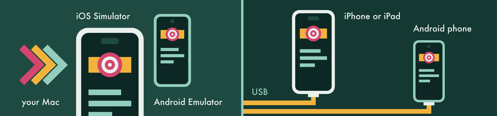
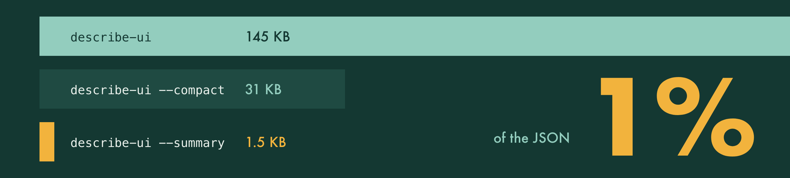
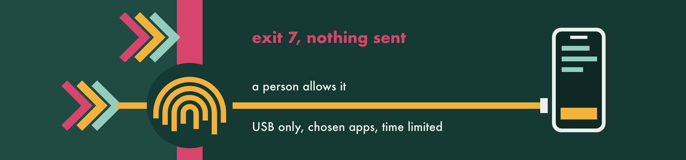
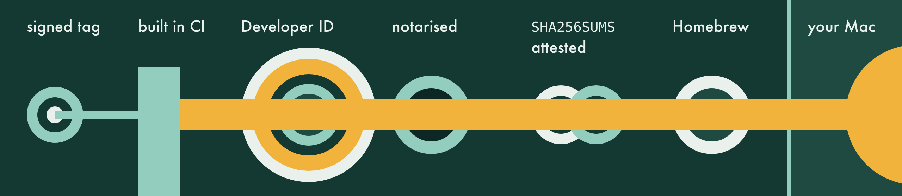

# Offsider

A hand for your agent on iOS and Android, simulated or real.

[](https://github.com/michael-palmes/offsider/actions/workflows/ci.yml)
[](https://github.com/michael-palmes/offsider/releases/latest)
[](LICENSE)

Offsider gives your coding agent eyes and hands on a phone. It reads the screen, taps, types, swipes and takes screenshots on iOS Simulators, Android Emulators, and iPhones, iPads and Android phones over USB. One command-line tool, running entirely on your Mac. [offsidercli.com](https://offsidercli.com/)

## Why Offsider



- **One tool, every device.** The same commands drive simulators, emulators and real phones.
- **Reads screens the way agents do.** `describe-ui --summary` fits a screen in a few lines, and `--diff` shows only what changed.
- **Proves the tap worked.** `--verify` waits for the screen to change, and exits 5 if it didn't.
- **Won't tap the wrong thing.** A target that's covered, off screen or under the keyboard is refused, and nothing is sent.
- **Says what to do next.** Every error has a reason, an exit code and the next command to run.
- **Knows React Native.** LogBox, the dev menu and Metro, on both platforms.
- **[Fast](#fast), [secure](#secure) and [private](#private)** with nothing to set up.

## Install

```bash
brew install michael-palmes/tap/offsider
```

You need an Apple silicon Mac on macOS 26 or later and Xcode 26 or later, plus the Android SDK for Android. [Requirements and the verified tarball](docs/install.md).

## Test a feature now

**1. Teach your agent.** Run this once, in your own terminal:

```bash
offsider init      # adds the Offsider skill to Claude Code, Codex or both
offsider doctor    # checks Xcode, your simulators and the Android SDK
```

**2. Ask for what you want tested.** In Claude Code or Codex:

> Use Offsider to test the feature on this branch on the iPhone simulator and the Android emulator. Walk through it like a user, check each step worked, save numbered screenshots to ./evidence and tell me what broke.

Your agent installs the build with your usual tools, then uses Offsider to read each screen, tap by id or label, check every step and save the evidence.

**3. Or drive it yourself.** These are the commands your agent uses:

```bash
offsider list-devices                                     # simulators, emulators and AVDs
export OFFSIDER_DEVICE=$(offsider boot "iPhone 17 Pro")   # or an AVD, such as Pixel_9
offsider describe-ui --summary                            # what's on screen
offsider tap --id search                                  # tap by id, or --label "Search"
offsider type $'kettle\n'                                 # type, then press Return
offsider tap --label "Add to cart" --verify               # exits 5 if nothing changed
offsider assert --id cart-badge --has-value 1             # exits 0 if true, 5 if not
offsider screenshot --output cart.png                     # password fields masked
```


Real iPhones and Android phones work too, once you allow each one with `offsider device-access allow`. [Getting started](docs/getting-started.md) covers Android and real devices.

## Fast


| Android Emulator median, 2 s pause before each tap | Offsider | Appium | agent-device | mobile-mcp | Maestro |
| --- | ---: | ---: | ---: | ---: | ---: |
| Tap by id | 0.09 s | 0.09 s | 0.21 s | 0.39 s | 2.1 s |
| Five steps | 0.49 s | 0.99 s | 1.8 s | 1.6 s | 4.5 s |
| First tap, with nothing running | 0.33 s | 4.3 s | 1.8 s | 1.6 s | 6.9 s |

<sub>Each tool's fastest warm route on one React Native screen and an API 36 emulator: Offsider (the build after 0.12.0, `batch` for the five steps), Appium 3.8.0 with UiAutomator2, and agent-device 0.21.27, mobile-mcp 1.0.11 and Maestro 2.11.0 over MCP. Medians of 20 taps, each checked to have landed, or 10 runs of the five steps (tap, wait, assert, tap, screenshot), with the tap count read on the first, last and every fifth run and the screenshot file checked on the rest, after 3 warm-ups. 4 of Appium's 20 taps took about 0.7 s. Tapping a bare point with the same 2 s pause, mobile-mcp (0.04 s) and Appium (0.09 s) are quicker than Offsider (0.11 s).</sub>



- **Straight to the emulator.** Taps, keys and screenshots go to the Android Emulator's own gRPC endpoint on loopback, not through `adb shell`: a tap lands in about 0.1 s and a screenshot in 0.15 s.
- **Warm on the emulator.** The screen reader stays running between commands, so after the first a `describe-ui --summary` takes 0.06 s and a `tap --id` 0.1 s.
- **Straight to the simulator.** Offsider reads and drives the iOS Simulator through Xcode's own simulator frameworks, with nothing installed inside it: a screen read takes 0.88 s and a screenshot 0.40 s.
- **Warm on the simulator.** The input session stays open between commands, so after the first a tap skips the 1 s it takes to open: a `tap --id` takes 0.91 s instead of 2.4 s.
- **Small reads.** A `--summary` is about 1 percent of the full JSON, and `--diff` sends only what changed, so your agent spends fewer tokens on every screen.
- **One trip for a whole flow.** `batch` sets up once, then runs every step: five steps take about half the time on iOS, and on Android, where every command is already warm, it still saves a quarter.
- **Warm sessions on real devices.** On a wired iPad, a session broker keeps the screen stream and touch open between commands: a tap in about 140 ms and a screenshot in about 230 ms.

| Median, back to back | iOS Simulator | Android Emulator |
| --- | --- | --- |
| Read the screen: `describe-ui --summary` | 0.88 s | 0.06 s |
| Tap a point: `tap -x -y` | 0.94 s | 0.10 s |
| Tap by id: `tap --id` | 0.91 s | 0.10 s |
| Tap and check it worked: `tap --id --verify` | 3.1 s | 0.53 s |
| Screenshot | 0.40 s | 0.15 s |
| Screenshot, password fields masked (the default) | 0.99 s | 0.13 s |
| Five steps in one `batch` | 2.4 s | 0.42 s |
| The same five steps as separate commands | 4.5 s | 0.56 s |

<sub>An Apple M1 Max driving the React Native playground on an iOS 27 simulator with Xcode 27.1 and an API 36 emulator, with the build after 0.12.0, which keeps the emulator's screen reader and the simulator's input session warm: medians of 20 runs back to back, or 10 for the five steps, after 3 warm-up runs. A session's first command opens what later ones reuse, so it takes about 0.3 s longer on Android and 1 s longer on iOS. The iPad figures were measured for 0.7.0.</sub>

## Secure

Built for the question your security team will ask: what can an agent do with this, and what can't it?



| Risk | Control |
| --- | --- |
| [An agent drives a real phone](SECURITY.md#physical-devices-the-allow-list) | Refused, with nothing sent, until a person runs `offsider device-access allow` in their own terminal and confirms with Touch ID or their password. Then it's USB only, never inside a browser or system app, pinned to one app on an iPhone, and it expires (12 hours by default). A configuration profile can cap or ban it. |
| [An agent grants itself more](SECURITY.md#scope-and-threat-model) | Allowing a device, linking a saved login, loosening one or saving an unlock code needs a person at a terminal and Touch ID or their password. No flag or variable skips it. |
| [Screen text gives the agent orders](SECURITY.md#what-reaches-your-agent) | Screen, log and notification text is treated as data: control and bidi characters print as escapes, strings stop at 500 characters, and the skill tells the agent to stop and ask. |
| [Secrets end up in output](SECURITY.md#saved-secrets) | Password fields read as bullets and are masked in screenshots, logs are redacted, and typed text never prints. Test logins live in the login Keychain, never synced. |
| [Local tampering](SECURITY.md#on-the-mac) | A private 0700 folder of 0600 files, opened without following symlinks, and sockets that refuse other users. |
| [A tampered release](SECURITY.md#release-integrity) | Signed tags, a build job with no secrets, Developer ID signing with library validation, notarisation, `SHA256SUMS` and a provenance attestation. Bundled files are checked against digests in the binary. |
| [Data leaves the Mac](SECURITY.md#network) | No telemetry, accounts or update checks. Only Unix sockets and loopback to the adb server, the emulator, usbmuxd and Metro. |



**Check it yourself:**

```bash
OFFSIDER=$(readlink -f "$(command -v offsider)")
codesign --verify --strict --verbose=2 "$OFFSIDER"      # valid on disk, unchanged
spctl --assess --type install --verbose=2 "$OFFSIDER"   # source=Notarized Developer ID
codesign -d --entitlements - "$OFFSIDER"                # empty, so library validation stays on
offsider doctor                                         # install.bundle: bundled files match the build
lsof -nP -iTCP -a -c offsider                           # while a command runs: 127.0.0.1 only
```

[SECURITY.md](SECURITY.md) is the full threat model and lists everything Offsider touches. To check a release tarball's checksum and attestation, see [Verified tarball](docs/install.md#verified-tarball). Report a vulnerability privately through the [Security tab](https://github.com/michael-palmes/offsider/security).

## Private


- **Nothing leaves your Mac.** No telemetry, no accounts and no update checks. Building the iPhone runner uses `xcodebuild`, which talks to Apple for provisioning, as Xcode does.
- **Your agent sees what the screen shows,** and that reaches its model provider. On a real phone, turn on Do Not Disturb or a Focus first.
- **Passwords stay hidden.** Password fields read as bullets, screenshots paint them black, and video won't start while one is on screen.
- **Logs are redacted.** Tokens, keys, emails, card numbers and one-time codes read `[redacted]` by default.
- **Evidence stays out of git.** Evidence runs mask emails too, and their folder gets a `.gitignore` of `*`.

See [what Offsider keeps on your Mac](docs/privacy.md#what-offsider-keeps-on-your-mac).

## Docs

- **Use it:** [Getting started](docs/getting-started.md) · [Commands](docs/commands.md) · [Reading the screen](docs/reading-the-screen.md) · [Input and checks](docs/input.md) · [Screenshots, video and logs](docs/capture.md)
- **Devices:** [Android](docs/android.md) · [iPhones and iPads](docs/ios-devices.md) · [Device access](docs/device-access.md) · [Device state and foldables](docs/device-state.md)
- **Apps:** [Sign in](docs/sign-in.md) · [React Native](docs/react-native.md)
- **Agents:** [The skill, device locks and leases](docs/agents.md)
- **When it breaks:** [Troubleshooting](docs/troubleshooting.md) · [Exit codes and errors](docs/errors.md)
- **Hack on it:** [Building from source](docs/building.md) · [Contributing](CONTRIBUTING.md) · [Changelog](CHANGELOG.md)

## Licence and origin

Offsider is released under the [MIT licence](LICENSE).

- Copyright (c) 2025 Cameron Cooke (AXe, from which Offsider is forked)
- Copyright (c) 2026 Michael Palmes (Offsider changes)

Offsider began as a fork of [AXe](https://github.com/cameroncooke/axe) v1.8.0 by Cameron Cooke, an iOS Simulator automation tool, used under the MIT licence. It has been developed independently since, adding Android emulators and phones, physical iPhones and iPads, and its own build, signing and release tooling. It is not endorsed by Cameron Cooke or the AXe project. Changes before the fork are in [AXe's changelog](https://github.com/cameroncooke/axe/blob/v1.8.0/CHANGELOG.md). [NOTICE.md](NOTICE.md) describes the fork and its dependencies, and [THIRD_PARTY_LICENSES](THIRD_PARTY_LICENSES) holds their licence texts, including Meta's idb MIT licence and the Apache 2.0 licence for swift-argument-parser, the gRPC Swift packages and the vendored Android Emulator proto.

Issues and pull requests are welcome: read [CONTRIBUTING.md](CONTRIBUTING.md) first. This project follows a [code of conduct](CODE_OF_CONDUCT.md).

Offsider is an independent project. It is not affiliated with, endorsed by or sponsored by Apple Inc. or Google LLC. iOS, Xcode, macOS and Simulator are trademarks of Apple Inc. Android is a trademark of Google LLC. Neither AXe nor Offsider is affiliated with, endorsed by, or associated with Deque Systems or its axe® accessibility products.
