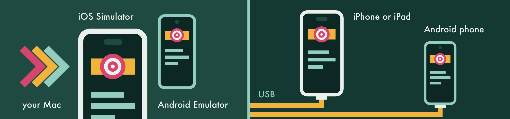
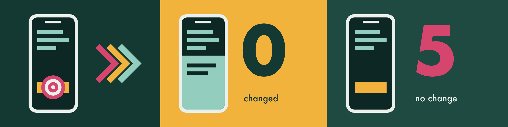
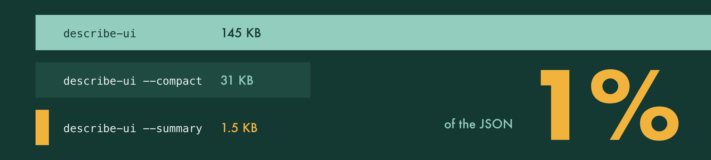
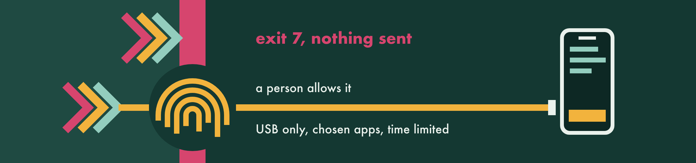
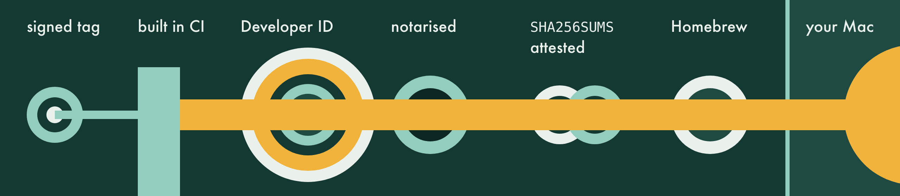
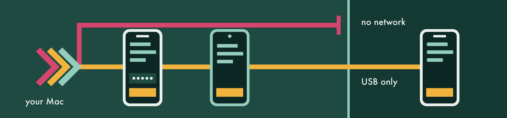

# Offsider

A hand for your agent on iOS and Android, simulated or real.

[](https://github.com/michael-palmes/offsider/actions/workflows/ci.yml)
[](https://github.com/michael-palmes/offsider/actions/workflows/codeql.yml)
[](https://scorecard.dev/viewer/?uri=github.com/michael-palmes/offsider)
[](https://github.com/michael-palmes/offsider/releases/latest)
[](LICENSE)

Offsider gives your coding agent eyes and hands on a phone. It reads the screen, taps, types, swipes and takes screenshots on iOS Simulators, Android Emulators, and iPhones, iPads and Android phones over USB. One command-line tool on your Mac, with no account and no telemetry. [offsidercli.com](https://offsidercli.com/)

## Why Offsider



- **One tool, every device.** The same commands drive simulators, emulators and real phones.
- **Reads screens the way agents do.** `describe-ui --summary` fits a screen in a few lines, and `--diff` shows only what changed.
- **Proves the tap worked.** `--verify` waits for the screen to change, and exits 5 if it didn't.
- **Won't tap the wrong thing.** A target that's covered, off screen or under the keyboard is refused, and nothing is sent.
- **Says what to do next.** Every error has a reason, an exit code and the next command to run.
- **Plain for agents, clear for you.** Your agent reads plain lines with nothing to strip; your terminal shows grouped tables, status dots and a spinner over every wait.
- **Knows React Native.** LogBox, the dev menu and Metro, on both platforms.
- **[Fast](#fast), [secure](#secure) and [private](#private)** with nothing to set up.

## Install

```bash
brew install michael-palmes/tap/offsider
```

You need an Apple silicon Mac on macOS 26 or later and Xcode 26 or later, plus the Android SDK for Android. [Requirements and the verified tarball](docs/install.md).

- **Managed Macs:** a configuration profile can turn phones off or limit them ([docs/mdm.md](docs/mdm.md)).
- **Versions:** Offsider is pre-1.0, so a minor release can change a command; the [changelog](CHANGELOG.md) lists each. Only the latest release gets fixes.

## Test a feature now

**1. Teach your agent.** Run this once, in your own terminal:

```bash
offsider init      # adds the Offsider skill to Claude Code, Codex or both
offsider doctor    # checks Xcode, your simulators and the Android SDK
```

**2. Ask for what you want tested.** In Claude Code or Codex:

> Use Offsider to test the feature on this branch on the iPhone simulator and the Android emulator. Walk through it like a user, check each step worked, save numbered screenshots to ./evidence and tell me what broke.

Your agent installs the build with your usual tools, then uses Offsider to read each screen, tap by id or label, check every step and save the evidence.

**3. Or drive it yourself.** These are the commands your agent uses:

```bash
offsider devices                                          # simulators, emulators and AVDs
export OFFSIDER_DEVICE=$(offsider boot "iPhone 17 Pro")   # or an AVD, such as Pixel_9
offsider describe-ui --summary                            # what's on screen
offsider tap --id search                                  # tap by id, or --label "Search"
offsider type $'kettle\n'                                 # type, then press Return
offsider tap --label "Add to cart" --verify               # exits 5 if nothing changed
offsider assert --id cart-badge --has-value 1             # exits 0 if true, 5 if not
offsider screenshot --output cart.png                     # password fields masked
```



Real iPhones and Android phones work too, once you add each one with `offsider devices add`. [Getting started](docs/getting-started.md) covers Android and real devices.

Test logins go in your login Keychain, not a script: `offsider credential add` saves one for your iOS and Android builds in one step, and `offsider login` signs in with it ([Sign in](docs/sign-in.md)).

## Fast


| Android Emulator median, 2 s pause before each tap | Offsider | Appium | agent-device | mobile-mcp | Maestro |
| --- | ---: | ---: | ---: | ---: | ---: |
| Tap by id | 0.09 s | 0.09 s | 0.21 s | 0.39 s | 2.1 s |
| Five steps | 0.49 s | 0.99 s | 1.8 s | 1.6 s | 4.5 s |
| First tap, with nothing running | 0.33 s | 4.3 s | 1.8 s | 1.6 s | 6.9 s |

<sub>Each tool's fastest warm route on one React Native screen and an API 36 emulator: Offsider (the build after 0.12.0, measured in October 2026, `batch` for the five steps), Appium 3.8.0 with UiAutomator2, and agent-device 0.21.27, mobile-mcp 1.0.11 and Maestro 2.11.0 over MCP. Medians of 20 taps, each checked to have landed, or 10 runs of the five steps (tap, wait, assert, tap, screenshot), with the tap count read on the first, last and every fifth run and the screenshot file checked on the rest, after 3 warm-ups. 4 of Appium's 20 taps took about 0.7 s. Tapping a bare point with the same 2 s pause, mobile-mcp (0.04 s) and Appium (0.09 s) are quicker than Offsider (0.11 s).</sub>



- **Straight to the emulator.** Taps, keys and screenshots go to the Android Emulator's own gRPC endpoint on loopback, not through `adb shell`: a tap lands in about 0.1 s and a screenshot in 0.15 s.
- **Warm on the emulator.** The screen reader stays running between commands, so after the first a `describe-ui --summary` takes 0.06 s and a `tap --id` 0.1 s.
- **Straight to the simulator.** Offsider reads and drives the iOS Simulator through Xcode's own simulator frameworks, with nothing installed inside it: a screen read takes 0.88 s and a screenshot 0.40 s.
- **Warm on the simulator.** The input session stays open between commands, so after the first a tap skips the 1 s it takes to open: a `tap --id` takes 0.91 s instead of 2.4 s.
- **Small reads.** A `--summary` is about 1 percent of the full JSON, and `--diff` sends only what changed, so your agent spends fewer tokens on every screen.
- **One trip for a whole flow.** `batch` sets up once, then runs every step: five steps take about half the time on iOS, and on Android, where every command is already warm, it still saves a quarter.
- **Warm sessions on real devices.** On a wired iPad, a session broker keeps the screen stream and touch open between commands: a tap in about 140 ms and a screenshot in about 230 ms.

| Median, back to back | iOS Simulator | Android Emulator |
| --- | --- | --- |
| Read the screen: `describe-ui --summary` | 0.88 s | 0.06 s |
| Tap a point: `tap -x -y` | 0.94 s | 0.10 s |
| Tap by id: `tap --id` | 0.91 s | 0.10 s |
| Tap and check it worked: `tap --id --verify` | 3.1 s | 0.53 s |
| Screenshot | 0.40 s | 0.15 s |
| Screenshot, password fields masked (the default) | 0.99 s | 0.13 s |
| Five steps in one `batch` | 2.4 s | 0.42 s |
| The same five steps as separate commands | 4.5 s | 0.56 s |

<sub>An Apple M1 Max driving the React Native playground on an iOS 27 simulator with Xcode 27.1 and an API 36 emulator, with the build after 0.12.0 (October 2026), which keeps the emulator's screen reader and the simulator's input session warm: medians of 20 runs back to back, or 10 for the five steps, after 3 warm-up runs. A session's first command opens what later ones reuse, so it takes about 0.3 s longer on Android and 1 s longer on iOS. The iPad figures were measured on 0.7.0, in October 2026.</sub>

## Secure

Built for the question your security team will ask: what can an agent do with this, and what can't it?



| Risk | Control |
| --- | --- |
| [An agent drives a real phone](SECURITY.md#physical-devices-the-allow-list) | Refused, with nothing sent, until a person runs `offsider devices add` in their own terminal and confirms with Touch ID or their password. Then it's USB only, for the apps and time that person chose: by default one app for 7 days or any app for 12 hours, at most 30 days, or until removed. Outside a test device, which a person says has nothing personal on it, it never drives a browser or system app, and an iPhone stays in one app per command. |
| [An agent grants itself more](SECURITY.md#scope-and-threat-model) | Allowing a device, linking a saved login, loosening one, saving an unlock code or turning off a mask needs a person at a terminal and Touch ID or their password. No flag or variable skips it. |
| [Screen text gives the agent orders](SECURITY.md#what-reaches-your-agent) | Screen, log and notification text is escaped, cut at 500 characters a string and marked `untrusted` in JSON, and the skill tells the agent it is data and to stop and ask. |
| [Secrets end up in output](SECURITY.md#saved-secrets) | Password fields read as bullets and are masked in screenshots, logs are redacted by pattern, and Offsider never echoes typed text. Test logins live in the login Keychain, never synced. |
| [Local tampering](SECURITY.md#on-the-mac) | A private 0700 folder whose files Offsider writes 0600 and opens without following symlinks, and sockets that refuse other users and other builds. |
| [A tampered release](SECURITY.md#release-integrity) | Signed tags, a build job with no secrets, Developer ID signing with library validation, notarisation, `SHA256SUMS` and a provenance attestation, and from 0.18.0 an attested SBOM and build record. Bundled files are checked against digests in the binary, and `codesign --verify` below catches a replaced binary. |
| [Data leaves the Mac](SECURITY.md#network) | No telemetry, accounts or update checks. Only Unix sockets and loopback to the adb server, the emulator, usbmuxd and Metro, and an iPhone's CoreDevice tunnel over USB. Apple's `xcodebuild` reaches Apple to build the iPhone runner. |
| [An agent taps something costly](SECURITY.md#app-guard) | An approved `offsider.guard.json` names the controls an agent asks you about, with Touch ID at the Mac, or never taps; an agent can tighten those rules but never loosen them. |
| [Your organisation needs a ceiling](docs/mdm.md) | A configuration profile turns phones off, or limits them to listed devices and apps, and caps what anyone may loosen, such as masks, saved logins and unlock codes. No one's allow-list goes past it. |
| [You need to know what it did on a phone](docs/device-access.md#audit-trail) | Every command that drives, is refused on, or changes access to a physical device leaves one record on the Mac and in the unified log, never arguments or screen text: `offsider devices status --audit`. |



**Check it yourself:**

```bash
OFFSIDER=$(readlink -f "$(command -v offsider)")
codesign --verify --strict --verbose=2 "$OFFSIDER"      # valid on disk, unchanged
spctl --assess --type install --verbose=2 "$OFFSIDER"   # source=Notarized Developer ID
codesign -d --entitlements - "$OFFSIDER"                # empty, so library validation stays on
offsider doctor                                         # install.bundle: bundled files match the build
lsof -nP -i -a -c offsider                              # while a command runs: loopback only, plus an iPhone session's sockets on its CoreDevice USB tunnel
```

For your security team: [one page](docs/security-overview.md) · [threat model](SECURITY.md) · [managed Macs](docs/mdm.md) · [check a download](docs/install.md#verified-tarball) · [report privately](https://github.com/michael-palmes/offsider/security).

## Private



- **Offsider sends nothing off your Mac.** No telemetry, accounts or update checks. Apple's `xcodebuild` reaches Apple when it builds the iPhone runner.
- **Your agent sees what the screen shows,** and sends it to its model provider. On a real phone, turn on Do Not Disturb or a Focus first.
- **Passwords stay hidden.** Password fields read as bullets, screenshots paint them black, and video checks for one before it starts.
- **Logs are redacted by pattern.** Tokens, keys, emails, card numbers and one-time codes read `[redacted]`.
- **Evidence stays out of git.** Evidence runs mask emails too, and their folder gets a `.gitignore` of `*`.

In plain words, with how to clear each thing Offsider keeps: [Privacy](docs/privacy.md).

## Docs

- **Use it:** [Getting started](docs/getting-started.md) · [Commands](docs/commands.md) · [Reading the screen](docs/reading-the-screen.md) · [Input and checks](docs/input.md) · [Screenshots, video and logs](docs/capture.md)
- **Devices:** [Android](docs/android.md) · [iPhones and iPads](docs/ios-devices.md) · [Physical devices](docs/device-access.md) · [Device state and foldables](docs/device-state.md)
- **Security:** [For security teams](docs/security-overview.md) · [Privacy](docs/privacy.md) · [Managed Macs](docs/mdm.md) · [Security policy](SECURITY.md)
- **Apps:** [Sign in](docs/sign-in.md) · [React Native](docs/react-native.md)
- **Agents:** [The skill, device locks and leases](docs/agents.md)
- **When it breaks:** [Troubleshooting](docs/troubleshooting.md) · [Exit codes and errors](docs/errors.md)
- **Hack on it:** [Building from source](docs/building.md) · [Contributing](CONTRIBUTING.md) · [Changelog](CHANGELOG.md)

## Licence and origin

Offsider is released under the [MIT licence](LICENSE).

- Copyright (c) 2025 Cameron Cooke (AXe, from which Offsider is forked)
- Copyright (c) 2026 Michael Palmes (Offsider changes)

Offsider began as a fork of [AXe](https://github.com/cameroncooke/axe) v1.8.0 by Cameron Cooke, an iOS Simulator automation tool, used under the MIT licence. It has been developed independently since, adding Android emulators and phones, physical iPhones and iPads, and its own build, signing and release tooling. It is not endorsed by Cameron Cooke or the AXe project. Changes before the fork are in [AXe's changelog](https://github.com/cameroncooke/axe/blob/v1.8.0/CHANGELOG.md). [NOTICE.md](NOTICE.md) describes the fork and its dependencies, and [THIRD_PARTY_LICENSES](THIRD_PARTY_LICENSES) holds their licence texts, including Meta's idb MIT licence and the Apache 2.0 licence for swift-argument-parser, the gRPC Swift packages and the vendored Android Emulator proto.

Issues and pull requests are welcome: read [CONTRIBUTING.md](CONTRIBUTING.md) first. This project follows a [code of conduct](CODE_OF_CONDUCT.md).

Offsider is an independent project. It is not affiliated with, endorsed by or sponsored by Apple Inc. or Google LLC. iOS, Xcode, macOS and Simulator are trademarks of Apple Inc. Android is a trademark of Google LLC. Neither AXe nor Offsider is affiliated with, endorsed by, or associated with Deque Systems or its axe® accessibility products.
