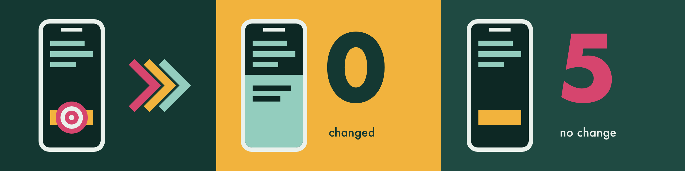
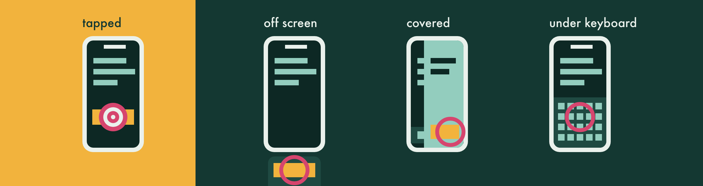

# Input

## Confirm the effect



Most input commands confirm dispatch, not effect. Add `--verify` to `tap`, `type`, `key` or `button` to wait for an observable change (accessibility tree, then screenshot); the command exits 5 if nothing changes.

- A tap on a switch, checkbox or radio button and `button app-switch` are not retried by default, since a second press would undo a change that lands late; wait for the new state instead.
- A retry is never sent while the screen is still changing: a change that came and went, a read that failed after the input, or a selector tap's target that moved away. Offsider watches one more `--verify-timeout` instead and verifies when the next screen settles, else exits 5 with `note` `unsettled`, sent once.
- A read that fails just before the input leaves the read before it as the baseline, so the check still runs its whole `--verify-timeout`. With nothing to compare at all (no tree and no screenshot), the input is sent once, the timeout is waited out, and it exits 5 with `note` `unreadable`. A screen that never has a tree still retries on its screenshots.
- A change counts only on the front page: text ticking on a screen beneath a full-screen page does not verify a tap, unless the tap aimed at that screen. The dev menu opening over the app fails the check (exit 5, `note` `devmenu_opened`, no retry) unless the tap aimed at its button.
- For a tap that navigates, `--verify-id <id>` waits for an element of the next screen to come to the front instead (default 10 s, no retries; with `--retries`, one goes only while nothing on screen changed). It judges the front as [`wait` does](reading-the-screen.md#what-counts-as-on-screen), so an id beneath a pushed page, such as the screen `Back` returns to, counts once that page goes. A failure says where the element is and whether anything changed. On a screen with ticking text, `--verify-ignore-text` ignores text and frame changes.
- Text that changed with no input between the previous command's read and this one (a live price or clock) and React Native LogBox toasts never count. The verified line names up to three changes and ends with its timing, `(settle 0.4 s, tap 0.1 s, verify 1.2 s)`.
- A screenshot change counts when it touches the target (its frame, or a coordinate tap's point, and one tile around it), or covers at least 2% of the screen. A smaller repaint elsewhere, such as a glass back button or the home indicator, is not the input's effect: the input is watched one more `--verify-timeout` instead of sent again, then exits 5 with `note` `unsettled`. `key`, `button` and plain `type` have no target, so only the 2% counts.
- A selector `tap` whose only change is the keyboard closing exits 5 with `note` `keyboard_closed`, sent once: in a React Native `ScrollView` the first tap after typing often only closes the keyboard. Tap again if the control shows no effect. A tap on the keyboard's own controls (Done, a key, a hide keyboard button), a coordinate tap, `key` and `button` still verify, with the note.
- When the change shows another app in front, the check asks whether the app the input aimed at still runs (iOS simulators and Android). If it stopped, the command exits 1 with `app_crashed`, naming the crash report or the Android exception, or `app_stopped` when nothing names it, and a hint to `app launch --restart`. An app that opened a link or a system prompt is still running, so that still verifies.
- `slider` always checks its value.
- `type --verify` sends its text once unless `--replace` or `--retries` asks for more, since text that lands late would be typed twice; a tap on a switch, checkbox or radio button holds back the same way. On exit 5, read the field before typing again.
- After a change, `type --verify` reads the field back (the `--into-*` field, or the one with focus): the text sent must appear in it in order, ignoring case and spacing, so a formatter's separators and capitals pass while a dropped or swapped key does not. With `--replace`, letters or digits beyond the text at either end fail too. A field whose value lags gets reads for up to another `--verify-timeout`. A field that does not hold the text exits 5 with `note` `text_differs`, sent once; set it with `type --replace`. `--json`'s `textCheck` is `match`, `differs` or `unknown`, never the text or its length; `unknown` means nothing could tell: a password field, `--verify-ignore-text`, text ending in Return, no field to read or focus that moved, text over 500 characters, or a value that moved but holds none of the text, such as `2 of 6 digits`. Autocorrect and smart punctuation read as `unknown` or, when they change only part of the text, `differs`.

At a terminal, a person sees a ✅ receipt for every input command, even those an agent reads nothing from, and never the typed text or its length. `--verify` shows ✅ with what changed and its timings, or ❌ with the commands to try next, and a retry as a ⚠️ line. An agent's lines are unchanged.

If input seems to be ignored, or screen reads fail, run `offsider doctor --device <ID>` (see [Doctor and troubleshooting](troubleshooting.md)).

### JSON results

Every input command takes `--json`: `tap`, `type`, `key`, `key-sequence`, `key-combo`, `button`, `swipe`, `drag`, `touch`, `gesture`, `slider` and `shake`. Stdout then holds one line, also on a failure, and the command's own lines move to stderr:

```json
{"version":1,"ok":true,"command":"tap","target":"id=save","dispatched":"yes","point":{"x":201,"y":640},"elapsedMs":182,"exitCode":0,"error":null}
```

- `target` is what the command line named: a selector, a point, `(x, y) to (x, y)`, a key or button, a preset. `type` says `text` and `key-sequence` says `keys`, never what they typed.
- `dispatched` is `yes`, `no` (nothing was sent, so a resend is safe) or `unknown` (a send began and failed: check the screen first). `ok` and exit 0 never mean the input worked, and a `slider` already at its value sends nothing (`dispatched` `no`).
- `tap` adds `point`, where it tapped (or, on a failure, aimed) in points; `slider` adds `percent`, the value it reached, and `value`, as its element reads it (listed in `untrusted`).
- `swipe` and `drag` with `--screenshot-at` add `holdMs`, how long the finger rested at the end, and `screenshots`: one object per screenshot, with `atMs` (the offset asked for), `startMs` and `endMs` (when it ran, from the moment the finger came to rest) and `screenshot --json`'s fields. A failure still lists the screenshots already written.
- A failure sets `ok` to false and carries the [JSON error object](errors.md#json-errors) in `error`, with `exitCode` to match. A usage error (exit 64) prints the plain error envelope, with nothing sent.
- With `--verify`, `tap`, `type`, `key` and `button` print the [verify report](errors.md#verify-reports) instead.
- `button home --verify` on an iOS simulator checks what answers at the screen's centre: it returns as soon as SpringBoard is in front, with `change: activity`, and exits 5 when it never is. When a system alert already answers there over an app, it compares the tree instead, as that answer proves nothing. `--verify-id` or `--verify-ignore-text` compare the tree instead.

### Screenshots during a hold

Another command cannot capture the screen while a gesture holds the device: `screenshot` exits 8 (`device_busy`) until the finger lifts, and by then a chart's scrub or a dragged item's hover has gone. Take the screenshot inside the gesture instead:

```bash
offsider swipe --start-x 40 --start-y 500 --end-x 300 --end-y 500 --hold-end 1500 --screenshot-at 300 --screenshot-at 1000 --output scrub.png --device <DEVICE_ID>
offsider drag --start-x 100 --start-y 300 --end-x 100 --end-y 600 --hold-ms 800 --screenshot-at 400 --output drop.png --device <DEVICE_ID>
```

- `--screenshot-at <ms>` (0 to 10000, up to 10 times) takes a screenshot that many milliseconds after the finger comes to rest at the end, before it lifts. Without `--hold-end` the finger rests until the last screenshot is done; with it, every `--screenshot-at` must fall within it.
- Each screenshot is masked as `screenshot` masks by default: password fields, `offsider.mask.json` and the evidence run's masks, from a tree read while the finger is down, just before the pixels. When a password field cannot be located, the image is withheld, the finger lifts and the command fails.
- `--output` takes a path or a folder, as `screenshot --output` does; several screenshots to one path are numbered `scrub-1.png`, `scrub-2.png`. Without it, each lands in the current folder under `screenshot`'s default name. In an evidence run, each is also numbered into the run.
- A screenshot takes time (about 0.1 to 0.5 s on a simulator or emulator, more on a phone), so it can start after its offset when the one before ran long, and when one runs past `--hold-end`, the finger stays down until it is done; a person sees a note, and `holdMs` says how long it rested.
- On Android the gesture goes as separate requests around each screenshot, so the screen read fits between them on the one UiAutomation helper; the helper keeps the finger down throughout, but sends no resting reports while a screenshot runs. A phone's helper starts before the finger goes down, so the first screenshot does not wait for it.
- Batch `swipe` and `drag` steps do not take `--screenshot-at`; run the gesture on its own.
- A slow `swipe` moves the finger at least every 0.1 s unless `--delta` says otherwise: held still longer, it can read as a long press, and a list that takes one then never scrolls. A `--delta` wider than the swipe rests under the finger for the whole `--duration`.
- `swipe --hold-end` moves in `drag`'s 60 steps unless `--delta` says otherwise. `swipe` and `drag` with `--hold-end` above 0 slow the finger over the last 3 points (pixels on Android), inside `--duration`, because a list reads its fling from the last moves, however long the hold. `--hold-end 0` lifts at full speed.
- A physical iPhone or iPad cannot hold a finger between requests, so `--screenshot-at` exits 1 (`not_supported`) there before anything is sent. Use an iOS simulator, or `--hold-end <ms>` and a `screenshot` after the lift.
- Ctrl-C or a kill signal during the hold sends the lift, then exits 130 or 143. A read that never returns on a simulator or emulator ends the command after 30 s with `device_unresponsive`, also lifting first. A `SIGKILL` gets no such chance: on Android the helper's broker cancels the touch when the command's connection goes, and a helper with no broker cancels it as it stops. On a gRPC emulator the emulator lifts it after 120 s.

### Two fingers and pinch

`touch -x <X> -y <Y> --fingers 2 --hold <ms>` holds two fingers still, and `gesture pinch` moves them:

```bash
offsider gesture pinch --from 60 --to 240 --device <DEVICE_ID>                            # spread: zoom in
offsider gesture pinch --from 240 --to 60 --x 200 --y 400 --duration 0.8 --device <DEVICE_ID>  # squeeze: zoom out
```

- The fingers sit on a horizontal line through `--x`,`--y` (default the middle of the app's frame), start `--from` points apart and end `--to` apart (each 20 to 600), moving about 60 times a second over `--duration` (0.1 to 10 s, default 0.5), then lift together. A finger that would leave the screen at either spread is a usage error, with nothing sent.
- An iOS simulator's main display takes it through its input session, and Android emulators through gRPC or, without gRPC, the UiAutomation helper, as Android phones do (the helper starts for the command). A physical iPhone and the iPhone Duo's inner display refuse two fingers, and `OFFSIDER_ANDROID_INPUT=input` refuses them on Android.
- It is a `batch` step too (`--step 'gesture pinch --from 60 --to 240'`). As with other input, check the effect: a screenshot, or a value the app shows.

## Selectors and taps



`--id`, `--label` and `--value` match `id`, `label` and `value`. Selectors prefer matches that are on screen: apps often keep views mounted off screen (a closed bottom sheet parked below the screen, rows below the fold), and a match whose frame lies outside the screen fails with an error naming its frame instead of tapping nothing. `--wait-timeout` waits for it to come on screen, and `--allow-offscreen` resolves it anyway. A match inside the screen but above or below what its scroll view or list shows, such as a row below the fold under a footer pinned beneath the list, fails with `target_off_screen` ("below the fold of its scroll view; scroll first"); a scroll view's sides never clip, since a carousel may draw cards past them. An element that is only partly on screen, or partly showing in its scroll view, is tapped at the centre of its visible part. When a `wait` or `assert` selector misses on an iOS simulator, the reason adds what a read at the screen's centre found (a presented view or a likely stale frame).

When no label or value matches exactly, typographic quotes and unusual spaces are folded (`--label "Don't Allow"` finds `Don’t Allow`), and a miss suggests the closest labels, saying which start with or hold your text. `--label-contains` matches a label that holds the text anywhere, in the same case and after the same folding, for a label React Native merged from several texts (`--label-contains 'Choose a layout'` finds `Choose a layout. Rows can show as a list or a grid, and the grid holds up to four columns.`); it can narrow an `--id` as `--label` does, and is refused beside `--label`. On Android, `--id alert_title` also matches `com.example:id/alert_title` when no id matches exactly. `--element-type` matches `role` in any case or the native `type` exactly, so `button`, `Button` and `RadioButton` all work.

### Covered targets and the keyboard

Before a selector tap, `tap` (and `type --into-id`) checks what a touch at the target's point would reach, by the rule `wait`, `assert` and `describe-ui --on-screen` share ([What counts as on screen](reading-the-screen.md#what-counts-as-on-screen)). When the iOS simulator's hit-test, or Android's drawing order, finds another element there, such as a pushed page's Buy button over a tab of the screen beneath, or the padding of a bar of controls such as a tab bar or a footer bar, it refuses with `target_covered` (exit 1), sends nothing and names the element in the message and in `coveredBy` (`role`, `id`, `label`, `frame`, `screen`, `evidence`: `hitTest`, `drawingOrder`, `treeOrder`, `logBoxTouchArea`, `devMenuTouchArea`, `systemBar` or `otherProcess`, and `process`). On an iOS simulator, when at least 8 pt of the target shows beside the cover, such as a list row half under a tab bar, it taps the middle of that part instead once a hit-test there finds the target, and says so on stderr; Android's tree leaves an opaque page's background out, so there it refuses. `--wait-timeout` reads again until the cover goes, and `--allow-covered` taps the target's own point anyway with a warning.

On an iOS simulator a prompt another process draws over the app, such as AutoFill's Save Password? after a sign-in, shows in the tree only as empty containers, which never cover on their own. While the tree shows that host, `tap` hit-tests anyway, and a view from a process the tree does not hold refuses with `evidence` `otherProcess`, the process in `process` and the prompt's title in `screen`. A tap on its backdrop would only dismiss it, so answer the prompt from a screenshot, or dismiss it with the backdrop tap the message gives, then retry.

When only tree order suggests a cover (a physical iPhone or iPad, an Android dump without drawing order, a hit-test that answers with only the screen's root, or an iOS hit-test that answers with a row while a control outside its scroll view, such as a floating footer, holds the point), `tap` warns and taps, and `--fail-if-covered` refuses instead.

`--fail-if-covered` asks to be sure, so on an iOS simulator it always hit-tests the point, even where nothing listed overlaps it: a scrim the tree leaves unnamed refuses, and a hit on an unnamed screen-sized view refuses as a possible veil, as does a point it cannot read. On Android the tree cannot tell a screen's own empty wrapper from a veil: both are empty, unlabelled views that take no presses. When that is the only doubt, `--fail-if-covered` takes a screenshot and reads the target's text there with macOS's on-device recognition, under 0.1 s, nothing leaving the Mac. The tap goes ahead when the whole label shows, with a note saying why; otherwise it refuses, naming the view (`Its text does not show in a screenshot`), as it does for an icon with no visible text, or text it cannot read, such as most scripts other than Latin. A see-through view with no press handler can pass, but a touch there presses nothing. A control, a pressable scrim or a view holding content always refuses. Some things never cover: system scroll indicators, which iOS lists as sliders such as "Vertical scroll bar, 3 pages" (a physical iPhone lists them as labelled elements of no known type); an element on a screen beneath the page the target is on, even one identical to it, such as the Back of the page beneath; anything holding the target, such as a clickable row around its info button; and anything but another key over a key, so a keypad the app draws over its amount field is clear. In Jetpack Compose a node that takes no taps, such as a row's text beside its button, passes the touch to what lies beneath it. On Android an unlabelled full-screen React Native view drawn over the target with nothing to touch at the point warns too, since React takes its touches, unless it sits on the target's own page, where Offsider judges what lies beneath it; a native host off every page, such as an Expo dev client's tools button, passes the touch on and does not warn. An overlay that is hidden from accessibility cannot be detected this way, except that on Android `--fail-if-covered` reads every view first (about 30 ms on a warm emulator), so a hidden page over the target refuses.

A React Native LogBox toast takes touches beyond the frame the tree gives it: from a point above its top edge (on Android, when the app draws under the status bar, the status bar's height higher still, as LogBox's toast list pads itself by it) to the bottom of the screen. A target whose point falls there is refused with `evidence` `logBoxTouchArea` on both platforms, and one whose frame only reaches that area warns (or, with `--fail-if-covered`, is refused).

On Android with three-button navigation, the navigation bar and the status bar are windows of their own over an app drawn behind them, and take every touch in their frame, so a tap on a row under the navigation bar could press Back or Home. A target whose point falls in a bar is tapped in the middle of the part showing beside it when 8 dp or more shows, with a note; otherwise it is refused with `evidence` `systemBar` and a hint, the `swipe` that scrolls it clear. Gesture navigation lists no bar, as its touches reach the app, so nothing changes there, nor with the uiautomator fallback, which reads no windows.

Expo's floating dev menu button takes touches on a 50 pt circle, though the tree gives only its 26 pt icon. A target whose point falls on the circle is refused with `evidence` `devMenuTouchArea`, and the hint is the `drag` that moves the button clear; on an iOS simulator a target showing beside the circle is tapped there instead.

`slider` makes the same keyboard and cover checks where its drag would start, at the thumb, since whatever takes that touch takes the whole drag: a sheet or the keyboard over it refuses with `target_covered` or `target_under_keyboard` and nothing is sent, rather than dragging the sheet. `--wait-timeout` reads again until the cover goes, and `--allow-covered` drags anyway with a warning. It never moves the drag to a part showing beside a cover.

### Disabled targets

A selector `tap`, a batch `tap` step and `type --into-id` refuse a control that says it is disabled, such as a Continue button while its form loads, with `target_disabled` (exit 1): the tap would do nothing, so nothing is sent, and the hint is the `wait --enabled` to run first. Text inside a disabled control counts as that control. A control that does not say is tapped, and so is text marked disabled inside an enabled row, as the row takes the touch. `--wait-timeout` reads again until the control is enabled, and `tap --allow-disabled` taps anyway with a warning, to prove a disabled control does nothing. Coordinate taps and `slider` are unchanged.

`tap --dry-run` finds the target and judges it as a tap would, then stops: nothing is sent and no input session opens, so an irreversible button can be tested safely. It exits as the tap would (`target_covered`, `target_under_keyboard`, `target_disabled`, `selector_not_found`), prints that nothing was sent, and `--json` carries `"dryRun":true` and `"dispatched":"no"`. It takes a selector, never `-x`/`-y` or `--verify`, and a `batch` step refuses it.

When the on-screen keyboard covers the target, `tap` and `type --into-id` always refuse with `target_under_keyboard` and send nothing, since the tap would press a key: hide the keyboard (on Android, `offsider button back`) or scroll the target above it, then retry. On Android the keyboard's own keys and buttons decide: `describe-ui` frames the keyboard by them, not by its window, which spans the screen around a floating or compact keyboard. When only a keyboard toolbar shows, as Gboard does with a hardware keyboard connected, the advice never names `button back`, which would go to the app and can leave the screen.

Plain `type`, with no `--into-*` or `--require-focus-id`, sends nothing unless a text field has focus (or, on an iOS simulator, a keyboard shows): it exits 1 `no_focused_field`, since keys that reach no field can act as app shortcuts, and a React Native dev build reloads on `r`. It reads the screen first, about 0.6 s on an iOS simulator. With a hardware keyboard connected no software keyboard shows, and a tree can leave a whole branch of the screen out, so before refusing, an iOS simulator reads points across the screen for a focused text field (about 1 s to find one on the centre line, about 3 s to find none). Focus on something that takes no text, such as the button of an app's own number keypad, refuses too: tap the keypad's keys instead. So does a field focused beneath a page drawn over it. On Android a keyboard up with no listed field focused means the field is hidden from accessibility, and is refused the same way, as an app's own keypad looks the same; for a real editor, `type --unlisted-field` sends the text anyway, as it would to a password field, and `--verify` shows whether it landed. A physical iPhone or iPad applies the same rule from its runner's tree; when the screen cannot be read it warns and sends. `key-sequence` with letters, digits, space or punctuation follows the same rule, and is refused in a password field (exit 64, `secure_field_argument`) unless the sequence holds a modifier; Return, Tab, arrows and other keys go out unchecked. `key` presses one key with no check on any platform, so a shortcut always gets through. On an iOS simulator, keys into a React Native app go 30 ms apart, so a field that sets its text from each change keeps up; a native app types as fast as before.

### Moving targets

Selector `tap`, `slider`, `type --into-id` and batch `tap` steps guard against a target still moving from an earlier input, such as a sheet sliding in. They act at once when the last input was 500 ms or more ago, or when the target sits within 1 pt of where the cached tree had it and the keyboard has neither opened nor closed since; otherwise they wait out the rest of 500 ms (150 ms when there is no cached tree), read once more and tap the target where it is now. A target missing from that read gets one more read 150 ms later, and when it is still missing the tap exits 2 (`selector_not_found`, with candidates) with nothing sent, since whatever now sits at its old point would take the tap; `--wait-timeout` keeps looking while it has time. `--no-settle` turns this off, for scripted loops that already wait. Under `tap --verify` the verifier's own second read does the same job, and the keyboard and cover checks run again on it, so the check covers the point the tap goes to: a target that has gone or come under a cover by then is refused with nothing sent. `tap --verify-id` makes no second read, so it keeps the guard. Within 2 s of an input, `tap` also reads a refused cover again for up to 1 s, as a page just left can stay in the tree for a moment, and `--no-settle` skips that too.

## Waits, assertions and batches

`wait` and `assert` exit 0 when their condition holds and 5 when it does not, so a script can branch on them. Only on-screen matches count unless `--allow-offscreen` is passed: a match on a screen beneath a pushed page, or one a touch at its point would not reach, such as a closed side menu's row the page is drawn over, does not ([What counts as on screen](reading-the-screen.md#what-counts-as-on-screen)), and the reason says what is over it (`under button "Filter Chip" (16, 180) 160x44, so a tap would not reach it`). Both take `--app <bundle-id>` on a physical iPhone, iPad or Android phone.

- `wait` waits until an element is on screen (`--id`, `--label`, `--label-contains`, `--value`, `--has-value`, `--enabled`, `--disabled`) or `--gone` (held for `--stable-for <ms>`, default 500 with `--gone`; an element a touch would not reach counts as gone, and the result says what hides it, so pass `--allow-offscreen` to ask whether the app still holds it; a read with nothing under the app, or one cut short, never counts as gone), the first of several with `--any` (repeat `--id`, `--label`, `--label-contains` or `--value`; with one selector it is a plain wait for it), the screen is `--settled` (`--ignore-values` lets ticking text pass; within 2 s of an input it also waits for that input's effect), a `--region x,y,w,h` is `--changed` or `--stable`, or `--seconds` pass (both up to 900 s); `--timeout`, `--json`. On timeout, a selector that found nothing names the closest element (`nearest` in `--json`). `--region` watches pixels, for content the accessibility tree cannot see, such as charts, maps and web views.
- `wait --seconds` is a plain pause: it needs no `--device`, and touches no device even when one is named.
- `--settled` leaves out what keeps moving on a live screen. `--ignore-id <id>` drops that element and everything under it; `--ignore-region x,y,w,h` (points, as `describe-ui` prints them) drops the elements at least half inside it and no bigger than it, and everything under them. Both are repeatable, and with `--settle-by both` or `screen` the pixels there do not count either (`--ignore-id` needs the tree, so not `screen`). A timeout on a screen that kept moving names what moved in the reason (its id, label or type and frame, and `off screen` or `beneath <element>`) and prints the flags to add (`leaveOut` in `--json`), checked on the wait's own reads so they let the next wait pass; a mover past the left or top edge prints `--ignore-region=-600,0,300,40`, with `=`. When no flag leaves it out and keeps anything to wait for, `leaveOut` is null, and when it does not show either, the timeout says `--settle-by screen` can pass. A flag that leaves out the whole screen exits 64 at once, since a pass would watch nothing; one that holds everything under the root keeps reading until `--timeout`, as a splash screen passes, and names itself in the last reason.
- On Android, after an input that changed the tree, `--settled` also waits for the pixels to hold still for `--quiet-ms`, for up to 2 s after the tree last changed, so the next screenshot shows the new screen rather than the one it is replacing. Pixels never fail the wait: a chart or a caret just takes the 2 s. It costs two or three captures (about 0.3 s on an emulator, 2 to 3 s on a slow phone), only after such an input; `--settle-by tree` skips it, and `--settle-by both` waits for still pixels however long they take.
- On a phone, `wait` counts another app in front as not yet met, such as a fingerprint prompt or the store during a cold start. Nothing is read from that app. It says so once, keeps checking (about once a second on Android, every `--poll-interval` on an iPhone or iPad), and carries on when your app returns; if the other app is still in front at `--timeout` it exits 1 `app_not_allowed`, naming it. A refusal no front app can change (no `--app` named, or one the phone may not drive) exits at once, and so does `assert`, which reads once.
- `assert` checks once that an element is on screen, optionally with `--has-value`, `--enabled` or `--disabled`, or `--gone` (a covered element counts as gone, and the result says what hides it).
- `--gone` needs a read that shows the screen. A read with no element under the app (after a crash, or on a blank screen) is not met with reason `the screen read empty`; when every read was empty, `wait` and `assert` exit 1 `tree_read_failed` (`Could not confirm gone: the screen read empty.`, hint `offsider doctor`). A read the source or the limits cut short (`the read was cut`) exits 5, as the element may simply lie past where it stopped: scroll to it, then check again. A selector miss on a cut tree says so too.
- A selector `wait` that times out, or a `--gone` about to pass, on a read that shows another app than its first (on `assert`, than the last command's), asks whether the app it began on still runs (iOS simulators and Android). If it stopped, it exits 1 `app_crashed` (naming the crash report or the Android exception) or `app_stopped`, with `app launch --restart` as the hint, instead of a timeout or a false pass. A wait that began on another app, such as the home screen, stays as it was.
- `wait --settled` that passes on a tree of fewer than 5 elements, as a splash screen holds, adds the note `Settled on a nearly empty screen; it may still be loading. Wait for an element.` and `"sparse": true` in `--json`; it still exits 0. `--id` with `--label` (or `--label-contains`) or `--value` must match one element, as in `wait` and `tap`. When nothing matched, it names the closest element.
- `--enabled` and `--disabled` judge the control a tap would: a button over plain text with its label, the deepest of controls nested in each other, and text inside a disabled button reads disabled. `--json`'s `match` is that element, with its `enabled`, or null when several separate elements qualify. A tree that does not say counts as neither.
- A person sees a spinner while they look, then ✅ with the time it took, or ❌ on stderr with the last state and the nearest element.
- On Android, both exit 1 (`logbox_inspector_open`) when React Native's LogBox inspector hides the app (`wait` once it has for 1.5 s), since a selector for the app cannot match until it closes.

`batch` takes the same commands as steps, so one call can run a whole case in one device session, from `--step`, `--file` or `--stdin`:

```bash
offsider batch --device <ID> --json \
  --step "tap --id open-filters" \
  --step "wait --id apply-filters" \
  --step "tap --id apply-filters" \
  --step "assert --id filter-state --has-value Applied" \
  --step "screenshot --output after.png --scale points" \
  --step "describe-ui --summary"
```

A step the words alone rule out (bad quoting, an unknown step, `--json`, `--verify`, `--screenshot-at`, `--device`, `--wait-lock`) exits 64 before any step runs; with `--continue-on-error` an unknown or malformed step is reported and the rest run. Steps are input steps (`drag` and `rn devmenu <item>` among them), `sleep`, and the read steps `wait`, `assert`, `screenshot` and `describe-ui`. Selector steps read the screen again after any step that sends input. A read step that starts within 100 ms of input, from an earlier step or the command just before the batch (unless `OFFSIDER_TREE_CACHE=off`), waits out the rest of those 100 ms first, once per input, so a screenshot or tree read shows what the input drew; `wait --settled`, `--region` and `--seconds` start at once, and a slower effect, such as a network reply, still needs a `wait` step. `batch` supports `--wait-timeout`, `--ax-cache`, `--no-settle` (tap steps skip the transition guard, and read steps the 100 ms wait), `--continue-on-error` and `--mask-secure` or `--no-mask-secure` (whether screenshot steps mask password fields, on by default; a step's own flag wins). `--file` follows the rules of `type --file`, with `--allow-path` for a refused location; a `type --file --allow-path` step reads a refused file only when `batch --allow-path` confirmed that path. `--stdin` reads at most 16 MB. A `type` step aimed at a password field, by `--into-*` or the focused field where the device reports focus, exits 64 (`secure_field_argument`) with nothing typed: sign in with `login`.

With `--json`, stdout is one NDJSON line per step (`step`, `kind`, `line`, `ok`, `ms`, plus `exitCode` and `error` on failure and each read step's own result; a read step's `ms` includes that 100 ms wait), then a summary line with `steps`, `failed` and `dispatched` (`yes`, `no` or `unknown`: whether any step sent input). A `type` step's line shows `<N characters>`, never its text, as do `--mask-text`, `--mask-label` and `--grep` values. Human text goes to stderr and ends a failure with `Dispatched: <state>`. A failed step's `error` is the [JSON error object](errors.md#json-errors). A reader that leaves early, as `| head` does, no longer stops a batch between steps: every step runs and the exit code stays the batch's own, so `set -o pipefail` sees it. `login` does the same.

Without `--json`, a person at a terminal sees a 📋 header, a row per step as it ends (`✓ 1  tap --id open  8 ms`, a `type` step's text as `<hidden>`), a dim `-` row for each step that did not run, and ✅ `Batch done` or ❌ `Batch stopped at step N`, with a warning to check the screen before resending when input may have reached the device. An agent or a pipe reads the same lines as before.

The batch exits with the code of its first step that failed to run, else 5 when a `wait`, `assert` or `screenshot --compare` condition was not met, else 0. Earlier steps may have run whatever the code, so resend a failed batch whole only when `dispatched` is `no`.

## Simulator input session

- On an iOS simulator, opening an input session takes about 1 s, so it stays open between commands. The first input command opens its own, as before, then starts a broker (`offsider` started detached, one per simulator) that holds one for the commands after it.
- The broker sends each command's input in turn and lifts any touch, key or button a command leaves down when it ends. `touch --down` and `--up` alone stay down until the matching command, as before. Input too long for it, such as pages of typed text, goes through the command's own session.
- It stops 60 s after the last command (`OFFSIDER_SIMULATOR_SESSION_IDLE`, at most 3600), when the simulator restarts, or on `offsider session stop --device <UDID>`; `session status` lists it. `OFFSIDER_SIMULATOR_SESSION=off` opens an input session for every command instead.
- A warm tap reaches the app within milliseconds of the command before it. On a screen that has only just appeared, use `tap --verify` or `wait --settled`.
