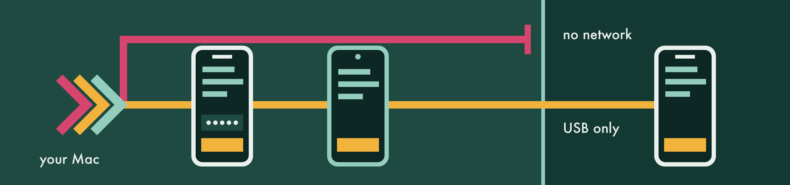

# Privacy



Plain words. The engineering version, with the file behind each line, is [SECURITY.md](../SECURITY.md); the page for a security team is [Offsider for security teams](security-overview.md).

## Offsider sends nothing off your Mac

No telemetry, no accounts, no update checks. Offsider talks only to this Mac and to devices on its USB cable. Three things reach further, and none of them is Offsider's own:

| What | When | Where it goes | Turn it off |
| --- | --- | --- | --- |
| Apple's `xcodebuild` | Building the iPhone runner | Apple, for your team's App IDs and profiles, as Xcode does | Build no runner |
| Homebrew | `brew install` | GitHub, and Homebrew's own analytics | `brew analytics off`, or the [verified tarball](install.md#verified-tarball) |
| Your agent | Whenever it runs Offsider | Its model provider gets what Offsider printed | Your agent's settings |

Mounting a developer disk image on an iPhone, which CoreDevice does on the first command or `doctor --fix`, may also ask Apple to personalise it, as Xcode does. That has not been checked yet.

## What your agent sees

- **The screen as text:** labels, values, ids and window titles, from `describe-ui`, `wait`, `assert`, `--verify` and errors, plus Android toasts and the text and buttons of a permission prompt (`alert show`).
- **The screen as pixels:** screenshots and video.
- **Logs:** device log lines from `logs`.
- **Notifications** that land on the screen. On a real phone, turn on a Focus (iPhone or iPad) or Do Not Disturb (Android) first.

Your agent sends what it sees to its model provider. Screen text is written by the app under test, so Offsider prints it as data: control and hidden characters show as escapes, each string stops at 500 characters, and the skill tells your agent to stop and ask when screen text asks for anything.

## What stays hidden, and its limits

| What | How it stays hidden | Its limit |
| --- | --- | --- |
| Passwords | Password fields read as bullets in every read, and `type` refuses argument text aimed at one | A secret in an ordinary field, a web view or a custom PIN pad can still show |
| Screenshots | Password fields and keyboard text (on Android beside the keys, on iOS the bar above them) are painted black by default, plus Android's copy preview and anything [`offsider.mask.json`](capture.md#mask-file) names. Behind an iOS sheet, Offsider paints where it last saw them and reads emails off the image on the Mac | Masks follow the accessibility tree; when it cannot see everything, the capture says `maskUnproven` |
| Video | Checks for password fields, keyboard text and anything `offsider.mask.json` names before it starts | One check, before the first frame |
| Logs | Tokens, keys, emails, card numbers and one-time codes read `[redacted]` | It works by pattern, so a secret under an unusual key or in free text still shows |
| Codes in the tree | One-time codes, card numbers, wallet addresses and recovery phrases read `[redacted ...]` | By pattern too |
| Typed text | Offsider never echoes it | Text passed as an argument shows in the Mac's process list; use `--stdin` for anything sensitive |
| Evidence runs | Emails are masked too, and the folder gets a `.gitignore` of `*` and a `.metadata_never_index` for Spotlight | The folder stays where you put it; the run stops recording after 7 days (`--expires`) |

Only you, at your own terminal, can turn off the password mask, log redaction or video's check. When an agent asks, Offsider wants your Touch ID or password, and no variable stands in for it. An agent can still edit `offsider.mask.json` or start an evidence run without email masks.

## What Offsider keeps on your Mac

Beyond the files you ask for, Offsider writes only to the places below. There is no single command that removes everything: each store has its own.

Most of it lives in a private folder, `offsider-<uid>/` in your per-user temp folder (`getconf DARWIN_USER_TEMP_DIR` prints where). Only you can open it.

| What | Where | Lasts | Clear it |
| --- | --- | --- | --- |
| The last screen tree from each device, masked | `trees/` in the private folder | 10 minutes | The next command deletes it; `OFFSIDER_TREE_CACHE=off` stops it |
| Screenshots taken with no `--output` inside a git checkout | `captures/` | Until you delete them | Delete them |
| The last Cloudflare Turnstile state per device, never page content | `turnstile/` | A day | It sweeps itself |
| Device locks | `locks/` | While a command runs | Nothing to do |
| Leases | `leases/` | Until the lease expires | `offsider lease release --device <ID>` |
| Evidence run records | `runs/` | While the run lasts | `offsider run stop` |
| Sign-in records, never a username or password | `signins/` | Until the next `login` | `offsider credential signed-out` |
| An Android device's auto-rotate before Offsider turned it | `orientation/` | Until it is turned back | `offsider orientation portrait --device <ID>` |
| A fold, Metro reverse or airplane mode Offsider set on a device | `postures/`, `reverses/`, `airplane/` | Until it is undone | `offsider session stop` |
| The pid of the adb server last found to be yours | `adb/` | Until another server answers | Delete the folder |
| A foldable phone's active panel and size | `displays/` | While the phone's state matches | `OFFSIDER_DISPLAY_CACHE=off` stops it |
| A failed unlock code marker, never the code | `unlock/` | Until the device is unlocked or the code saved again | `offsider unlock-code set` or `offsider unlock-code remove` |
| Emulator boot logs | `logs/boot-<avd>.log` | Emptied past 5 MB | Delete the file |
| iPhone and iPad runner records and logs | `ios-devices/<UDID>/` | While a session runs | `offsider session stop --device <UDID>` |
| Broker sockets and logs: the iPhone session broker, `android-<hash>.sock` and `.log` for the Android warm helper, `simulator-<hash>.log` for the simulator input broker | `sessions/` | While a broker runs; logs emptied past 5 MB | `offsider session stop` |
| The simulator input broker's sockets | `$TMPDIR/offsider-hid-<uid>/` | While a broker runs | `offsider session stop` |
| The phones you allowed, beside a lock file | `~/.config/offsider/allowed-devices.json` and `.allowed-devices.lock` | Each entry until it expires | `offsider devices remove` |
| The allow-list's seal | Login Keychain (`com.mpalmes.offsider.devices`) | As long as the list | `offsider devices remove` rewrites it |
| The app guard rules you approved, beside a lock file, and their seal | `~/.config/offsider/guards.json` and `.guards.lock`; the seal in the login Keychain (`com.mpalmes.offsider.guards`) | Until removed | No command yet: delete the files and the Keychain item together (the file alone holds its apps until you approve again) |
| Test logins and their links between apps | Login Keychain, never synced | Until removed | `offsider credential remove` |
| Unlock codes | Login Keychain, never synced | Until removed | `offsider unlock-code remove` |
| The iPhone runner's build and the bundle prefixes you approved | `~/Library/Caches/offsider/runner/`, `approved-prefixes`; its seal in the login Keychain (`com.mpalmes.offsider.runner`) | Until removed | `offsider session stop --device <UDID> --clean` for a device's build; delete the folder for the rest, and the seal with `security delete-generic-password -s com.mpalmes.offsider.runner` |
| The skill `init` installs | `~/.claude/skills/offsider`, `~/.agents/skills/offsider` or your `--dest` | Until removed | `offsider init --uninstall` |
| The permission rules `init` adds | `~/.claude/settings.json` (`permissions.ask`) and `~/.codex/rules/offsider.rules` | Until removed | By hand for now: `init --uninstall` leaves them |
| An emulator's gRPC public key, with `OFFSIDER_ANDROID_GRPC_AUTH=jwt` only | The emulator's `jwks` folder | While the command runs | The next command removes one a killed command left |
| Screenshots, recordings and evidence run folders | Where you put them | Until you delete them | Delete them; Offsider never does |

`offsider session stop` stops every broker, then you can delete the whole private folder:

```bash
rm -rf "$(getconf DARWIN_USER_TEMP_DIR)offsider-$(id -u)"
```

### On a device and in your Apple team

| What | Where | Lasts | Clear it |
| --- | --- | --- | --- |
| The Android helper, Offsider's own code | `/data/local/tmp/offsider-helper-<hash>.dex` on the device | Until a newer helper replaces it | `adb -s <serial> shell rm /data/local/tmp/offsider-helper-*.dex` |
| The iPhone runner apps | The iPhone or iPad | Until removed | `offsider session stop --device <UDID> --clean` |
| Settings a command changed: appearance, text size, permissions and permission prompt answers, status bar, stay awake, airplane mode, posture | The device | Until reset | Each command's reset ([Device state](device-state.md)) |
| The runner's App IDs and profiles, and a device registration if you chose a team in `devices add` or ran `--register-device` | Your Apple team | Until removed there | Certificates, Identifiers & Profiles on the Apple developer site |

## Phones and tablets

A real phone, iPhone or iPad is refused until you add it with `offsider devices add` in your own terminal and confirm with Touch ID. Then it works over USB only, for the apps and time you chose, and never inside a browser or system app unless you marked it a test device with nothing personal on it. [Physical devices](device-access.md) has the details.

## For organisations

An administrator can set a ceiling with a configuration profile: turn phones off, or limit them to listed devices and apps. The profile and each person's allow-list must both say yes, and a bad profile refuses rather than opens. [Managed Macs](mdm.md) has a sample profile.

## Report a problem

Report a privacy or security issue privately through the [Security tab](https://github.com/michael-palmes/offsider/security). [SECURITY.md](../SECURITY.md#reporting-a-vulnerability) says what to include and when to expect a reply.
